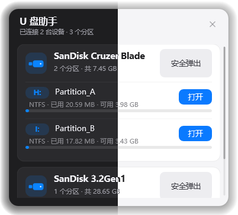
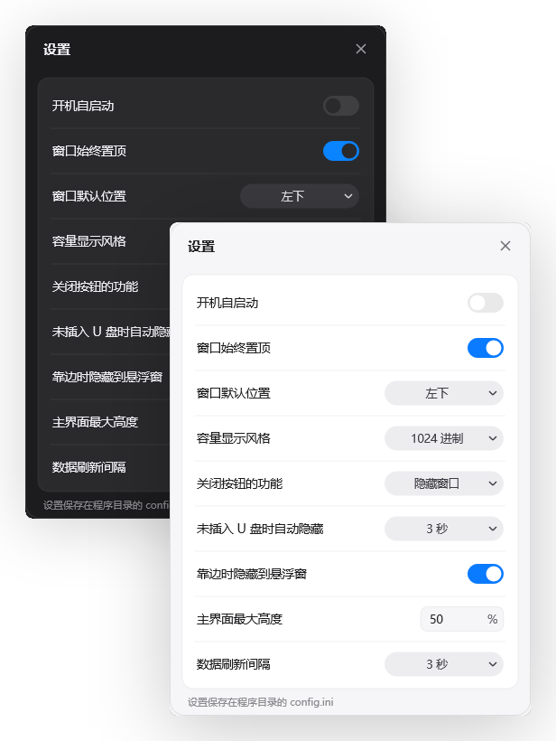
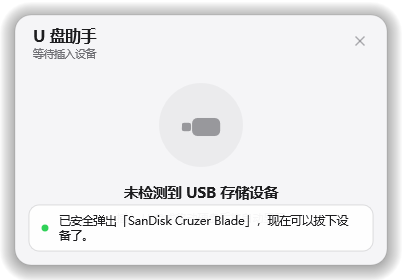
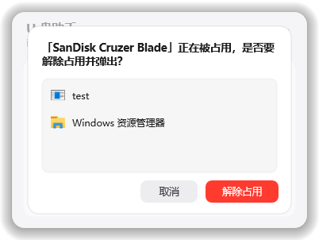

<div align="center">


<h1 style="line-height:1;">🚀 U 盘助手 (USB assistant)</h1>


</div>

# 📕简介

一个用 C++ 和纯 Win32 API 写的 Windows 桌面 U 盘 / 移动硬盘小工具。常驻托盘，自动列出当前的可移动设备并显示容量占用，支持一键安全弹出、查看并解除文件占用，界面用 Direct2D 自绘，跟随系统明暗主题并适配 DPI。

## 📸 界面预览

| 名称 | 图片 |
| --- | --- |
| 主界面 |  |
| 设置 |  |
| 全部弹出 |  |
| 解除占用 |  |

## ✨ 功能

- **设备列表**：自动枚举可移动磁盘（U 盘、移动硬盘、读卡器），显示盘符、卷标、文件系统、总容量 / 剩余空间与占用比例。
- **安全弹出**：先请求 PnP 移除，失败时回退到介质弹出，并在弹出后校验磁盘是否真正消失；避免「已弹出却提示失败」。
- **占用检测与解除占用**：枚举系统句柄定位正在使用该磁盘的进程，可一键结束这些进程后再弹出；explorer 不会被结束。
- **边缘悬浮条**：把窗口拖出屏幕边缘（上 / 下 / 左 / 右）后自动收起成 42×42 的悬浮图标，点击后从对应边缘滑入恢复；判定基于去除阴影后的真实窗体边界，任务栏所在的那条边不参与判定。
- **托盘常驻**：单击托盘图标显示 / 隐藏主窗口，右键菜单提供「显示窗口 / 设置… / 退出」。
- **外观**：Direct2D + DirectWrite 圆角卡片、滚动条悬浮加粗、明暗两套配色、淡入淡出与滚动动画、高 DPI 自适应。
- **便携配置**：设置保存在程序目录的 `config.ini`（不可写时退回 `%APPDATA%\UsbAssistant`）。

## 🧱 技术栈

| 层次 | 方案 |
| --- | --- |
| 语言 / 标准 | C++17 |
| 平台 | Win32 API（无 MFC / Qt / 第三方 UI 库） |
| 绘制 | Direct2D 1.0（`ID2D1DCRenderTarget` + `UpdateLayeredWindow` 分层窗口）、DirectWrite |
| 系统集成 | SetupAPI / CfgMgr32（设备枚举与 PnP 移除）、NtQueryObject（占用句柄扫描）、Shell API（托盘、通知、自启动快捷方式） |
| 构建 | CMake，MinGW-w64（亦可用 MSVC） |
| 运行时依赖 | 无（MinGW 下静态链接 `libgcc` / `libstdc++` / `winpthread`） |

## 📂 目录结构

```
.
├── CMakeLists.txt          # 构建脚本
├── docs/
│   └── screenshots/        # README 中的界面截图
├── res/
│   ├── app.rc              # 资源脚本（应用图标）
│   ├── app.ico             # 应用图标（16–256 多尺寸）
│   └── icon_preview.png    # 图标预览
└── src/
    ├── main.cpp            # 入口、单实例、--autostart
    ├── app.h / app.cpp     # 窗口、消息循环、拖拽、动画、托盘、边缘悬浮条
    ├── canvas.cpp          # D2D 渲染目标封装
    ├── render.cpp          # 全部界面绘制（卡片、按钮、弹层、滚动条）
    ├── device.cpp          # 可移动设备枚举
    ├── eject.cpp           # 安全弹出（PnP 移除 / 介质弹出 / 结果校验）
    ├── occupant.cpp        # 占用进程扫描与结束
    ├── settings.cpp        # config.ini 读写、开机自启
    ├── settings_window.cpp # 设置窗口
    ├── tray_menu.cpp       # 自绘托盘右键菜单
    ├── theme.cpp           # 明暗主题与配色
    └── com_ptr.h           # COM 智能指针
```

## 🔨 构建

运行环境：Windows 10 / 11（`WINVER=0x0A00`）。需要 CMake ≥ 3.20 和一个支持 C++17 的编译器（推荐 MinGW-w64）。

```powershell
cmake -S . -B build -G "MinGW Makefiles"
cmake --build build
```

或使用 MSVC：

```powershell
cmake -S . -B build -G "Visual Studio 17 2022"
cmake --build build --config Release
```

产物：`build/bin/UsbAssistant.exe`（MSVC 下在 `build/bin/Release/`）。

## 🎯 使用

- 直接运行 `UsbAssistant.exe` 即可；再次运行会激活已有窗口而不是重复启动。
- 命令行参数 `--autostart`：开机自启标记，启动后只驻留托盘、不显示主窗口（由设置中的「开机自启动」自动写入启动文件夹快捷方式）。
- 主窗口可拖动，拖到屏幕边缘后收起为悬浮条；悬浮条位置与窗体边界对齐，点击后按所在边缘方向滑入。
- 托盘图标：左键显示 / 隐藏窗口，右键打开菜单。
- 关闭按钮的行为（退出程序 / 隐藏到托盘）在设置里可选，并可关闭退出确认提示。

## ⚙️ 配置文件

`config.ini` 使用 `[General]` 段，首次运行自动保存；也可以在设置窗口中修改。

| 键 | 默认值 | 说明 |
| --- | --- | --- |
| `TopMost` | `1` | 窗口始终置顶 |
| `PosMode` | `0` | `0` 固定在角落，`1` 记住上次位置 |
| `Corner` | `3` | 角落：`0` 左上、`1` 左下、`2` 右上、`3` 右下 |
| `RefreshSec` | `3` | 容量数据轮询间隔（秒），`0` 关闭 |
| `CapacityBase` | `1024` | `1024` Windows 风格，`1000` 硬盘厂商风格 |
| `CloseAction` | `0` | `0` 退出程序，`1` 隐藏窗口 |
| `SkipCloseConfirm` | `0` | `1` 关闭时不再确认 |
| `EmptyHideSec` | `0` | 无设备时自动隐藏的秒数，`0` 不隐藏 |
| `EdgeCollapse` | `0` | `1` 允许拖到屏幕边缘收起为悬浮条 |
| `MainHeight` | `90` | 主界面最大高度占可用高度的百分比（20–100） |
| `HasLastPos` / `LastX` / `LastY` | `0` / `0` / `0` | 上次窗口位置（`PosMode=1` 时使用） |

## 🛠 实现要点

- **分层窗口 + D2D**：窗口四边预留 15 逻辑像素透明阴影，绘制到 DC 后由 `UpdateLayeredWindow` 合成，因此边缘判定使用内缩后的真实面板矩形。
- **手动拖拽**：自绘窗口不进入系统移动循环，拖拽由 `SetCapture` + `GetCursorPos` 实现，松开时按最近边缘决定是否收起。
- **占用扫描**：`NtQuerySystemInformation(SystemExtendedHandleInformation)` 遍历句柄，先复制句柄再查询对象类型 / 名称，并按对象类型索引缓存结果，避免逐句柄查询阻塞。
- **弹出校验**：磁盘设备节点消失或所有分区盘符消失都视为弹出成功；若失败还会在设备列表刷新后二次确认。

## 🎨 图标许可

`res/app.ico` 为本项目自行绘制生成的原创图标（圆角渐变底 + 白色「弹出」符号），不含任何第三方素材，可随本项目自由使用与商用。

## 📄 许可证

本项目采用 MIT 许可证 - 查看 [LICENSE](./LICENSE) 文件了解详情
