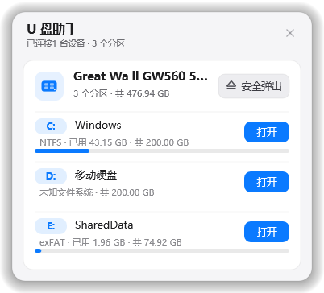
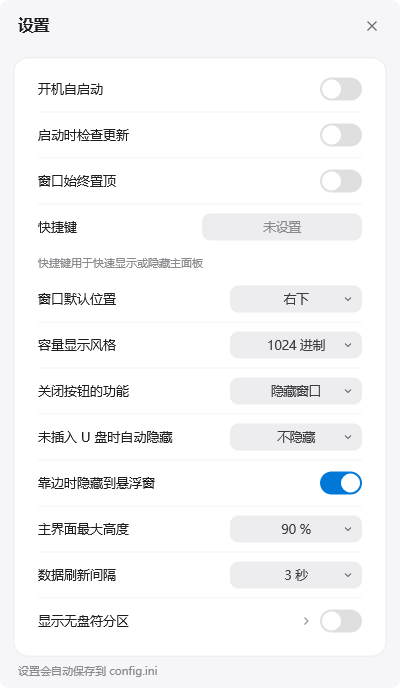

<div align="center">


<h1 style="line-height:1;">🚀 U 盘助手 (USB assistant)</h1>


</div>

一个用 C++20 + 纯 Win32 API + Direct2D/DirectWrite 写的 Windows 桌面 U 盘工具。常驻托盘，自动列出 USB 存储设备与分区，支持安全弹出、查看并解除文件占用；界面自绘、跟随系统明暗主题、适配高 DPI。

## 界面预览

> 支持深色模式

| 主界面 | 设置 |
| --- | --- |
|  |  |

## 功能

- [x] **设备列表**：只枚举 USB 总线上的物理磁盘，按磁盘聚合分区；显示盘符、卷标、文件系统、总容量/已用/剩余与占用条。
- [x] **隐藏分区**：可选显示无盘符分区（ESP / MSR / 未挂载），默认隐藏；可分别控制 ESP、MSR 与其他无盘符分区。ESP 等可挂载分区支持「挂载」（分配驱动器号，等同磁盘管理）与「取消挂载」，退出或隐藏时自动撤销本程序分配的盘符。
- [x] **安全弹出**：PnP 移除 → 介质弹出 → 强制锁定/卸载后重试；明确区分「被占用 / 权限不足 / 已拔出 / 不支持 / 失败」。
- [x] **占用检测与解除**：枚举系统句柄定位占用进程，可一键结束后再弹出；`explorer.exe` 只关闭相关窗口、绝不结束，系统关键进程一律跳过。
- [x] **管理员模式**：需要提权的操作统一弹出带 UAC 盾牌的自绘确认框，确认后用 `runas` 启动同一个 exe 的 `--helper` 执行弹出 / 解除占用 / 挂载 / 取消挂载并回传结果；主程序无需重启，已具管理员权限时直接执行。
- [x] **托盘常驻**：左键显示窗口，右键自绘菜单（显示 / 设置 / 退出）；启动后延迟补注册一次、之后每 15s 检查图标是否仍在，资源管理器重启后自动恢复。Windows 11 可能把新图标放进任务栏溢出区，这是系统行为，可在「设置 → 个性化 → 任务栏 → 其他系统托盘图标」中固定。
- [x] **边缘悬浮图标**：窗口拖到屏幕工作区边缘后收起为 42px 圆角悬浮条，图标由矢量绘制（沿用软件图标的三角形 + 底座造型，浅色主题纯黑、深色主题纯白），点击从对应方向滑入恢复；任务栏所在边不参与判定。
- [x] **设置**：开机自启动、启动时检查更新、始终置顶、快捷键、默认位置、容量进制、关闭按钮功能、无设备自动隐藏、靠边收起、主界面最大高度、刷新间隔、显示无盘符分区（可展开分别控制 ESP / MSR / 其他）。
- [x] **外观**：Direct2D 圆角卡片、淡入淡出、滚动动画、明暗配色、高 DPI 自适应；边缘悬浮条使用分层窗口逐像素透明 + GDI+ 抗锯齿矢量绘制，圆角外完全透明；窗口/托盘菜单/设置窗口都按所在显示器的工作区定位，多显示器下不会跳回主屏。配置保存在程序目录 `config.ini`，不可写时退回 `%APPDATA%\UsbAssistant`。
- [x] **检查更新**：启动 5 秒后自动检查（默认开启，可在设置中关闭），也可在「关于」中手动检查；检查、下载与替换由独立的 `UsbAssistantUpdater.exe` 完成，按 Release/Debug 与 x64/x86 匹配对应压缩包，替换后自动重新启动主程序。
- [x] **单实例**：再次启动会激活已有窗口，不会重复驻留。

## 目录结构

```text
UsbAssistant/
├── CMakeLists.txt
├── README.md
├── ARCHITECTURE.md          # 模块边界、线程模型、弹出状态机
├── LICENSE
├── res/                     # 图标与资源脚本
├── screenshots/             # README 预览图
├── tests/core_tests.cpp     # 不依赖界面的核心单元测试
└── src/
    ├── main.cpp             # 入口：单实例 / --autostart / --helper
    ├── core/                # 系统逻辑（无 UI 依赖）
    │   ├── models.h/.cpp    # Device / Partition / Occupant / EjectResult
    │   ├── text.h/.cpp      # 字符串清洗、容量格式化、版本信息
    │   ├── settings.h/.cpp  # config.ini、启动快捷方式
    │   ├── storage.h/.cpp   # SetupAPI / CfgMgr32 / IOCTL 原语
    │   ├── devices.h/.cpp   # USB 设备与分区枚举
    │   ├── eject.h/.cpp     # 安全弹出三级流程
    │   ├── occupants.h/.cpp # 句柄扫描、结束占用、关闭资源管理器窗口
    │   ├── elevation.h/.cpp # 提权助手协议
    │   ├── app_control.*    # 单实例查找、优雅退出与重启
    │   ├── update.h/.cpp    # Release 版本与资产匹配
    │   ├── http.h/.cpp      # WinHTTP 下载
    │   ├── zip.h/.cpp       # 更新包解压
    │   ├── log.h/.cpp       # 诊断日志
    │   └── version.h        # 版本号与展示标识
    ├── app/
    │   ├── application.h/.cpp # 业务编排：窗口/托盘/设置/对话框/任务
    │   ├── post_target.h       # 后台结果的安全回传目标
    │   ├── worker.h/.cpp      # 串行后台任务队列
    │   └── updater_app.h/.cpp  # 独立升级器：检查、下载、替换、重启
    └── ui/
        ├── theme.h/.cpp         # 明暗配色
        ├── canvas.h/.cpp        # 分层窗口离屏画布
        ├── text.h/.cpp          # DirectWrite 字体与文本
        ├── draw.h/.cpp          # 图形、图标、开关、复选框
        ├── main_view.h/.cpp     # 主界面 layout / paint / hit-test / 鼠标
        ├── settings_window.*    # 设置窗口
        ├── about_window.*       # 关于窗口（版本与检查更新入口）
        ├── updater_window.*     # 升级器进度窗口
        ├── message_dialog.*     # 自绘提示 / 确认框
        ├── tray_menu.*          # 自绘托盘菜单
        ├── edge_bar.*           # 边缘悬浮条（分层窗口 + GDI+ 矢量图）
        └── dpi.h                # DPI 辅助
```

## 构建

环境：Windows 10/11、CMake ≥ 3.21、支持 C++20 的编译器。

MinGW-w64（推荐，静态链接，产物无运行时依赖）：

```powershell
cmake -S . -B build -G "MinGW Makefiles"
cmake --build build
```

MSVC：

```powershell
cmake -S . -B build -G "Visual Studio 17 2022" -A x64
cmake --build build --config Release
```

运行测试（测试目标默认不编译，需显式开启）：

```powershell
cmake -S . -B build -DUSBASSISTANT_BUILD_TESTS=ON
cmake --build build --config Release
ctest --test-dir build --output-on-failure
```

产物（仓库根目录只保留一个 `build`；x86 使用 `build/x86` 子目录）：

- MinGW（单配置）：`build/UsbAssistant.exe`、`build/UsbAssistantUpdater.exe`
- MSVC x64：`build/Release/UsbAssistant.exe`、`build/Release/UsbAssistantUpdater.exe`；Debug 在 `build/Debug/`
- MSVC x86：`build/x86/Release/` 与 `build/x86/Debug/`（配置命令为 `cmake -S . -B build/x86 -G "Visual Studio 17 2022" -A Win32`）
- 测试（开启 `USBASSISTANT_BUILD_TESTS` 时）：与 exe 同目录，如 `build/Release/usbassistant_tests.exe`

## 使用

- 直接运行 `UsbAssistant.exe`；再次运行会激活已有窗口。
- `--autostart`：开机自启标记，启动后只驻留托盘、不显示主窗口（由设置中的「开机自启动」写入启动文件夹快捷方式）。
- 主窗口可拖动；开启「靠边收起」后拖到屏幕边缘会变成悬浮条。
- 托盘左键显示窗口，右键打开菜单。
- 设置中可录制「显示/隐藏主面板」的全局快捷键（默认未设置）；有悬浮条时按快捷键会从悬浮条直接恢复。
- 「关闭」按钮默认**隐藏到托盘**，保证托盘图标常驻；也可在设置中改为「退出程序」，并可关闭退出确认。

## 配置

`config.ini` 位于 exe 同目录；不可写时使用 `%APPDATA%\UsbAssistant\config.ini`。

| 键 | 默认值 | 说明 |
| --- | --- | --- |
| `TopMost` | `1` | 窗口始终置顶 |
| `PosMode` | `0` | `0` 固定角落，`1` 记住上次位置 |
| `Corner` | `3` | `0` 左上、`1` 左下、`2` 右上、`3` 右下 |
| `RefreshSec` | `3` | 容量轮询间隔（秒），`0` 关闭 |
| `CapacityBase` | `1024` | `1024` Windows 风格，`1000` 厂商风格 |
| `CloseAction` | `1` | `0` 退出程序，`1` 隐藏窗口（默认，托盘常驻） |
| `SkipCloseConfirm` | `0` | `1` 关闭时不再确认 |
| `EmptyHideSec` | `0` | 无设备自动隐藏秒数，`0` 不隐藏 |
| `EdgeCollapse` | `0` | `1` 允许拖到屏幕边缘收起 |
| `AutoCheckUpdates` | `1` | `1` 启动 5 秒后自动检查更新 |
| `HotkeyMods` / `HotkeyVk` | `0` / `0` | 全局快捷键的修饰键与虚拟键码，`0` 表示未设置 |
| `ShowHiddenPartitions` | `0` | `1` 显示无盘符分区（ESP / MSR / 未挂载） |
| `ShowEspPartitions` | `1` | 显示 ESP 分区（在显示无盘符分区时生效） |
| `ShowMsrPartitions` | `1` | 显示 MSR 分区（在显示无盘符分区时生效） |
| `ShowOtherHiddenPartitions` | `1` | 显示其他无盘符分区（在显示无盘符分区时生效） |
| `MainHeight` | `90` | 主界面最大高度（可用高度百分比，20–100） |
| `HasLastPos` / `LastX` / `LastY` | `0` / `0` / `0` | 上次窗口位置（`PosMode=1` 时使用） |

开机自启动不使用注册表，而是启动文件夹里的 `U盘助手.lnk`。

## 安全弹出流程（简述）

1. `CM_Request_Device_EjectW`：从最上层 USB 节点开始请求移除。
2. 若被明确否决为「仍有句柄打开」→ 立即进入占用界面，不再做无意义的等待。
3. 失败时尝试 `IOCTL_STORAGE_EJECT_MEDIA`（读卡器/部分 U 盘）。
4. 仍未断开则逐个 `FSCTL_LOCK_VOLUME` + `FSCTL_DISMOUNT_VOLUME`，**先关闭自身句柄**，再请求一次 PnP 移除（自身句柄会否决移除）。
5. 每步都以「磁盘节点消失 或 所有目标盘符消失」为成功标准，超时返回失败。

完整状态机与线程模型见 [ARCHITECTURE.md](ARCHITECTURE.md)。

## 诊断日志

- Debug 构建默认开启；Release 构建默认关闭（关闭时不创建文件、不做格式化）。Release 需要临时排查时，设置环境变量 `USBASSISTANT_LOG=1` 后再启动（PowerShell：`$env:USBASSISTANT_LOG='1'; .\UsbAssistant.exe`），`0` 可强制关闭。
- 位置：优先写在 exe 同目录的 `usbassistant.log`；仅当该目录不可写时才回退到 `%APPDATA%\UsbAssistant\usbassistant.log`。文件第一行会写明本次实际使用的路径与来源。
- 单文件上限 2 MB，超出后滚动为 `usbassistant.1.log`，最多保留 3 份备份；写入在后台线程完成，不阻塞界面。
- 每行包含时间、线程、级别与模块，错误码同时给出十六进制值。覆盖：设备/分区枚举与过滤原因、安全弹出的节点选择与每次系统调用结果、占用扫描与释放/排除原因、提权弹窗与 helper 参数及结果、配置加载与关键设置变化。
- 只记录设备路径、实例 ID、卷 GUID、进程名与 PID 等定位信息，不记录文件内容或用户数据。内容为 UTF-8 文本，可直接附给开发者排查。

## 测试与验证

- 开启 `USBASSISTANT_BUILD_TESTS` 后，`ctest` 覆盖：字符串清洗、容量格式化、配置读写与范围归一化、日志行格式、版本比较与 Release 资产匹配、更新包解压、提权参数编解码、危险设备号的安全返回、无盘符目标处理、占用进程存活判定。
- 已人工验证：空状态、明暗主题、多设备滚动、设置窗口、托盘菜单、关闭确认、边缘悬浮条收起/恢复、单实例、托盘退出、配置持久化。
- 设备枚举与真实弹出依赖实际 USB 硬件；本机无 USB 存储设备时只验证了空状态与逻辑分支。建议插入 U 盘/移动硬盘后重点验证：多分区设备、被占用设备、管理员模式弹出、读卡器介质弹出。

## 许可证

MIT，见 [LICENSE](LICENSE)。图标为旧项目自绘原创素材，随本项目一并使用。
